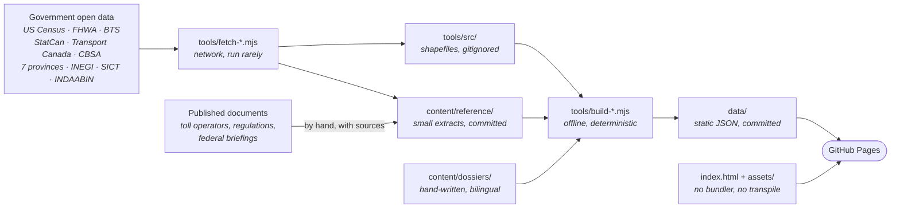

<div align="center">

<h1>Pacific Highway Atlas</h1>

<h3><em>numbered highways on both sides of the Pacific</em></h3>

<p>
An interactive, bilingual atlas of every numbered highway in the United States, Canada and
Mexico — the Interstates, the US numbered routes, every state route system, the
Trans-Canada Highway, Canada's National Highway System, every numbered provincial route,
and Mexico's federal and numbered state highways — with a written record for the roads
that have one. An East Asia view adds mainland China's national expressways, national
highways and provincial roads, drawn from OpenStreetMap, Taiwan's 國道 and 省道, and Hong
Kong's strategic routes.
</p>

[](https://andyuneducated.github.io/pacific-highway-atlas/)
[](docs/ARCHITECTURE.md)
[](docs/ACCURACY.md)

<br/>

<!-- auto:badges -->


<!-- /auto:badges -->


<!-- auto:deps --><!-- /auto:deps -->


<sub><b>[Live site](https://andyuneducated.github.io/pacific-highway-atlas/)</b> ·
[Architecture](docs/ARCHITECTURE.md) ·
[Accuracy](docs/ACCURACY.md) ·
[Data sources and decisions](docs/DATA-SOURCES.md) ·
[Coverage](#coverage) ·
[Known gaps](#known-gaps) ·
[Data sources](#data-sources) ·
[Building](#building) ·
[Second machine](#working-on-a-second-machine)</sub>

<br/>

[](https://andyuneducated.github.io/pacific-highway-atlas/)

<sub>The Interstates in cyan, the Trans-Canada in red, on the continent they actually cover.</sub>

</div>

---

> [!NOTE]
> **Counts move; method does not.** Every route total, mileage and percentage on this page
> is written from the published build dated **<!-- auto:date -->2026-10-31<!-- /auto:date -->** by
> `tools/readme-figures.mjs`, which `npm test` runs, and changes whenever the pipeline is
> re-run. The rules those numbers obey are in [On accuracy](#on-accuracy) and do not change.

## What it does

| | |
| --- | --- |
| **Map** | MapLibre GL over a dark vector basemap, with satellite and terrain alternatives and every route in the network selectable. |
| **Route detail** | Termini, length, per-jurisdiction mileage, roadway classification and grade separation measured off the geometry; alongside them, what the states, provinces and SICT measured — traffic, heavy-truck volume, pavement condition, lanes, posted speeds — each stating the share of the road it covers. For curated routes, a written account of how the road came to be, what it cost, what it carries and what condition it is in. |
| **Speed limits** | Every route coloured by its limit, in three named tiers: posted limits from HPMS and the NRN for the United States and Canada, OpenStreetMap's `maxspeed` for Mexico, China, Taiwan and Hong Kong, and the statutory default for the class of road where neither covers it, drawn fainter. A route's panel shows the limit as a sign, its source and coverage, and the mix of limits along it; the statistics page charts each network by limit. |
| **Dates** | A route's panel lists its designation and completion years and the dated events between, from its dossier or, for Quebec's autoroutes, the tronçon openings. |
| **Border crossings** | 167 land crossings on the Canada–US, Mexico–US, Mexico–Guatemala and Mexico–Belize borders, and 69 of the mainland's 84 highway ports, Hong Kong's and Macao's among them, each saying how it was placed and listing the atlas routes within 2 km of it. |
| **Toll facilities** | Seven Canadian toll roads and bridges on the map, each with its operator, length, opening date and dated fares, every fact linked to its source, and Mexico's 1,376 toll plazas with their operator and toll system. A route's panel lists the tolls on it, and for Mexico the federal concession titles that name it. |
| **Bridges** | 20,037 structures from Mexico's federal free network and the provincial highways of Ontario and Quebec, and from closer in the 196,860 US bridges in the National Bridge Inventory that carry an atlas route, coloured by the year each was built. The year dates the structure, never the road. |
| **Flythrough** | Follows a route's mainline end to end with the camera down on the pavement. |
| **Numbering explainer** | Why I-5 is on the west coast and I-95 on the east, and why the US routes run the other way — drawn rather than described. |
| **Statistics dashboard** | Network totals by system and by jurisdiction, every country and region; length by speed limit; and, for the Interstates, FHWA's mileage open to traffic, 1960–1997, by decade. |
| **Elevation profiles** | Sampled from open terrain data for every national route and every route with a dossier. |
| **Units** | Miles or kilometres everywhere, switched in one place. |
| **Command palette** | <kbd>/</kbd> or <kbd>Ctrl</kbd>+<kbd>K</kbd> to reach any route, jurisdiction or view. |
| **Map on its own** | <kbd>Z</kbd> fades every panel off the map and back again. |
| **Bilingual** | Full English and 简体中文 parity, enforced by a build check. Quebec routes keep their official French names in both modes, with an English gloss. |


<sub>I-95 selected. The percentage beside a reported figure is the share of the route it was
measured over, because partial coverage is stated rather than rounded up to the whole road.</sub>

## How it fits together

Nothing is computed in the browser that could be computed once, offline. The `fetch-*`
scripts download government open data, the `build-*` scripts turn it into routes and
layers, and the result is committed to `data/` as plain JSON that the page reads as-is.
**[docs/ARCHITECTURE.md](docs/ARCHITECTURE.md)** has the full pipeline, the stitching
algorithm, the client module graph and every source quirk that once produced a wrong atlas.



## Coverage

<!-- auto:summary -->28,290 routes across 147 states, provinces, territories and counties in 6 countries and regions, measuring 1,208,817 miles of road, in the build dated 2026-10-31.<!-- /auto:summary -->

<!-- auto:coverage -->
| Country | System | Routes | Miles | Notes |
| --- | --- | --- | ---: | --- |
| 🇺🇸 | Interstate Highways | 471 | 50,827 | includes Alaska's four unsigned A-series and Hawaii's H-series |
| 🇺🇸 | US Numbered Routes | 1,082 | 156,105 | the pre-1956 grid, numbered opposite to the Interstates |
| 🇺🇸 | State Routes | 15,092 | 358,127 | routes in 52 states and territories, loaded per state |
| 🇨🇦 | Trans-Canada Highway | 33 | 8,048 | the designation, traced across the provincial highways that carry it |
| 🇨🇦 | National Highway System | 806 | 36,894 | Core, Feeder, and Northern and Remote, as designated by Transport Canada |
| 🇨🇦 | Provincial & Municipal Routes | 2,900 | 69,855 | routes in 12 provinces and territories, loaded per jurisdiction |
| 🇲🇽 | Federal Highways | 176 | 24,092 | numbered roads the federation administers |
| 🇲🇽 | State Highways | 1,714 | 21,937 | numbered state roads in 32 states, loaded per state; most state roads carry no number |
| CN | National Expressways (国家高速) | 287 | 87,417 | from OpenStreetMap, not an official source (D-66); G with one, two or four digits |
| CN | National Highways (普通国道) | 331 | 175,727 | from OpenStreetMap (D-66); G with three digits |
| CN | Provincial Roads (省道) | 5,283 | 215,835 | from OpenStreetMap (D-66), numbered roads in 31 provinces, loaded per province |
| TW | National Freeways (國道) | 10 | 622 | the numbered freeways and their lettered spurs |
| TW | Provincial Highways (省道) | 95 | 3,182 | including the 快速公路 expressways, 台61 and up; provisional 臨 alignments left out |
| HK | Strategic Routes | 10 | 149 | Routes 1 to 10 |
<!-- /auto:coverage -->

Nunavut has no numbered route in the national road file, and no road connects it to the
rest of Canada, so it appears in no tier. In Mexico only numbered roads become routes; the
unnumbered network is drawn as faint background (see [Known gaps](#known-gaps)). Macao numbers
none of its roads, so it has no routes to draw; its crossings with the mainland are drawn, on the
mainland side (D-82).

## On accuracy

Every figure is one of three kinds, and they are never mixed:

| Kind | Examples | Shown with | When there is none |
| --- | --- | --- | --- |
| **Measured** from the geometry | length, termini, mileage per jurisdiction, roadway-class mix | a note that it was derived | cannot be absent |
| **Reported** by a state, province or SICT | traffic, trucks, pavement condition, lanes, speeds | the share of the route it covers | nothing is shown |
| **Published** by an authority | official mileage, cost, designation, opening dates, tolls | its source and date | the page says so |

<!-- auto:accuracy -->Across the 266 routes where FHWA publishes a length to check against, the median disagreement is −0.1%; 66% land within 5% and 82% within 10%.<!-- /auto:accuracy --> The larger
disagreements are explained on the route page rather than corrected toward the register,
and the register's figure is always shown beside the measured one.

| Rule | Where it is enforced |
| --- | --- |
| A figure is either measured or published, never a blend of the two | `build-data.mjs` computes the first; `content/` carries the second with its source |
| A published figure carries a source, or an explanation of why none exists | `build-content.mjs` fails the build otherwise |
| Every English string has a Chinese counterpart, with matching placeholders | `check-i18n.mjs` fails otherwise |
| Reported figures are joined to routes by **designation, never by position** | `attachHpms` and `attachCanadianTraffic` in `build-data.mjs` |
| Any figure covering part of a road states the share it covers | every HPMS and provincial measure carries a `cover` field |
| A route's length is measured along the path you would drive, once | `stitchRoute` and `drivenEdgeKm` in `geo.mjs` |
| Where a source says nothing, the site says nothing | no defaulting to zero; `null` survives to the panel |
| A fare is shown only with the date it took effect | `content/reference/tolls-ca.json` records none without one |
| A concession is linked by name only where a person accepted the match | `approved` in `content/reference/mx-concession-matches.json` |

The long form, with worked examples and which provinces publish traffic, is in
**[docs/ACCURACY.md](docs/ACCURACY.md)**.

## Known gaps

What the atlas does not show, and why, is a register in
**[docs/ACCURACY.md §6](docs/ACCURACY.md#6-known-gaps)**: each gap is a *source* gap (no
publisher releases it in a usable form), *pending* (available, not yet built) or *not planned*
(available, decided against). The ones a reader meets first:

- **Mexico**: no opening years, most state roads unnumbered, toll and free twins sharing a
  number, route ends given as SICT sections rather than towns.
- **Mainland China**: drawn from OpenStreetMap, since no authority publishes geometry readable
  from abroad; no official lengths, traffic or toll share per route.
- **Canada**: traffic unpublished in six jurisdictions; official lengths only in six provinces.
- **Speed limits**: shown only where a source posts one; the rest is left blank, never filled
  with a default.
- **Not planned**: a Spanish interface, CAPUFE toll-road data, Canadian pavement condition.

## Data sources

Every source, with its edition, retrieval date, licence and the decisions about its use, is in
**[docs/DATA-SOURCES.md](docs/DATA-SOURCES.md)**, which the site also shows on its Data &
Sources page. In short:

| Country | Geometry and designation | What the authorities report |
| --- | --- | --- |
| 🇺🇸 | US Census TIGER/Line 2025 (public domain) | FHWA HPMS 2024, Route Log, National Bridge Inventory; BTS border data |
| 🇨🇦 | Statistics Canada National Road Network, Transport Canada NHS (OGL – Canada) | provincial traffic files and section inventories, CBSA offices, Ontario and Quebec bridges, toll operators |
| 🇲🇽 | INEGI / SICT / IMT *Red Nacional de Caminos* 2025 (Libre Uso) | SICT *Datos Viales* traffic, federal bridges, concession titles; INDAABIN border ports |
| CN | [OpenStreetMap](https://www.openstreetmap.org/copyright) via Geofabrik ([ODbL 1.0](https://opendatacommons.org/licenses/odbl/1-0/), © OpenStreetMap contributors) | the 2022 national highway plan; the National Office of Port Administration's port list |
| TW | NLSC centrelines; Highway Bureau register (OGDL 1.0) | Freeway Bureau sections, tolls and volumes; Highway Bureau survey and roughness |
| HK | Transport Department *Road Network* | Annual Traffic Census, toll tables |

The data under `data/geo/cn/` is derived from OpenStreetMap and is available under the same
licence ([D-66](docs/DATA-SOURCES.md#mainland-china-1)). Across all of them: OpenStreetMap
speed limits, lanes and structures where no authority publishes them, labelled as such; AWS
Terrain Tiles for elevation; OpenFreeMap and Esri World Imagery as basemaps.

## Dependencies

**Nothing from npm reaches the browser.** The packages below are used only by the scripts in
`tools/`. The one library the page loads is MapLibre GL JS, vendored into the repository
rather than fetched from a CDN.

| Scope | Package | Used by | What for |
| --- | --- | --- | --- |
| `dependencies` | [shapefile](https://github.com/mbostock/shapefile) | `tiger.mjs`, `canada.mjs`, `mexico.mjs`, `taiwan.mjs`, `mx-states.mjs`, `border.mjs` | streams `.shp`/`.dbf` pairs a feature at a time, so a 2.4 GB attribute file need not fit in memory |
| `dependencies` | [pngjs](https://github.com/pngjs/pngjs) | `build-elevation.mjs` | decodes Terrarium terrain tiles |
| `devDependencies` | [playwright-core](https://playwright.dev/) | `verify.mjs`, `shoot-hero.mjs`, `shoot-bases.mjs`, `fetch-quebec-autoroutes.mjs` | drives headless Chromium |
| `devDependencies` | [pdfjs-dist](https://github.com/mozilla/pdf.js) | `fetch-mexico-designations.mjs` | reads the road index out of SICT's per-state PDFs |
| vendored | [MapLibre GL JS](https://maplibre.org/) 4.7.1 | `index.html` | the map, from `assets/vendor/` |

Everything else (route stitching, the shortest-path search, simplification, the ZIP reader
with Zip64, an `.xlsx` reader, CSV decoding) is plain Node in `tools/`. The page needs no API
key and no account. At runtime it talks to three public tile services, none of which carries
the atlas's own data:

| Service | When | Needed for |
| --- | --- | --- |
| [OpenFreeMap](https://openfreemap.org/) `tiles.openfreemap.org` | always | the dark vector basemap |
| [AWS Terrain Tiles](https://registry.opendata.aws/terrain-tiles/) `s3.amazonaws.com` | on demand | hillshading and the 3D terrain mesh |
| [Esri World Imagery](https://www.arcgis.com/home/item.html?id=10df2279f9684e4a9f6a7f08febac2a9) `server.arcgisonline.com` | on demand | the satellite basemap |

## Building

There is no build step for the site: `index.html` and `assets/` are served exactly as they
sit in the repository. The scripts below rebuild the *data*.

| Script | Does | Writes |
| --- | --- | --- |
| `npm run fetch` | Census gazetteer, FHWA Route Log, HPMS | `tools/src/`, `content/reference/` |
| `npm run fetch:ca` | StatCan NRN, Transport Canada NHS, provincial traffic | `tools/src/ca/`, `content/reference/` |
| `npm run fetch:qc` | the MTQ répertoire, for autoroute opening years | `content/reference/qc-autoroutes.json` |
| `npm run fetch:mx` | INEGI Red Nacional de Caminos, SICT traffic, SICT's road index | `tools/src/mx/`, `content/reference/` |
| `npm run fetch:mx:check` | preflight only: what is reachable, how big, whether it can resume | — |
| `npm run fetch:tw` | NLSC freeway and provincial centrelines, the Highway Bureau's provincial register | `tools/src/tw/` |
| `npm run fetch:hk` | the Transport Department's road network, keeping the numbered routes | `tools/src/hk/` |
| `npm run fetch:bridges` | bridge inventories with a year built; the National Bridge Inventory | `content/reference/bridges.json`, `tools/src/us/` |
| `npm run fetch:borders` | CBSA and INDAABIN crossing lists; geocodes the Canadian offices; places the mainland's ports from OpenStreetMap | `content/reference/border-crossings.json`, `cn-crossings.json` |
| `npm run fetch:tolls` | SICT's concession register (Canadian facilities are kept by hand in `tolls-ca.json`) | `content/reference/mx-concessions.json` |
| `npm run fetch:all` | every fetch above, in order | all of the above |
| `npm run build` | every `build-*` step, `build-data` first and `build-insights` last | `data/` |
| `npm run build:elevation` | samples terrain along curated routes | `data/elevation/` |
| `npm run propose:tolls` | proposes concession-to-route matches for review | `content/reference/mx-concession-matches.json` |
| `npm run check:mx` | cross-checks Mexican route numbers against SICT | `content/reference/mx-crosscheck.json` |
| `npm run serve` | serves the repository on `http://localhost:8787` | — |
| `npm test` | unit tests (`test/`), i18n parity, content validation, cross-file data consistency, README figures; CI runs it on every push | `README.md` figures |
| `npm run verify` | drives the served site in headless Chromium | `tools/shots/` (gitignored) |

```sh
npm install
npm run fetch:all       # acquire everything — slow, run rarely
npm run build           # offline and deterministic
npm run serve           # http://localhost:8787
npm test                # checks, and refreshes the README's figures
npm run verify          # headless run-through against the served site
```

`build-data.mjs` is the slow step: a shortest-path search over a graph built from every road
fragment in six countries and regions, taking tens of minutes. It needs no network once the sources are
on disk, except that TIGER/Line and Natural Earth download themselves on first use.

## Working on a second machine

A fresh clone serves the site immediately, since `data/` is committed, but cannot rebuild it
until the sources are back on disk. Everything under `content/reference/` is committed, so only
the large downloads need fetching again:

| Path | On disk | Comes from |
| --- | ---: | --- |
| `tools/src/ca/` | ~5.4 GB | `npm run fetch:ca` (a 1.5 GB download; shapefiles inflate on unpacking) |
| `tools/src/mx/` | ~3.2 GB | `npm run fetch:mx` |
| `tools/src/tw/` | ~34 MB | `npm run fetch:tw` |
| `tools/src/hk/` | ~1 MB | `npm run fetch:hk` (a 507 MB download, filtered as it streams) |
| `tools/src/tiger/` | ~476 MB | the build itself, one state at a time |
| `tools/src/ne/` | ~49 MB | the build itself, on first use |
| `tools/src/2023_Gaz_place_national.txt` | 6 MB | `npm run fetch` |
| `tools/cache/` | ~96 MB | `build-elevation.mjs`, only if terrain profiles are rebuilt |

The fetchers are resumable: they skip whatever is already on disk, so a dropped connection costs
one re-run. None of it can be committed; GitHub rejects files over 100 MB.

| Source | Re-fetching reproduces the data? |
| --- | --- |
| TIGER/Line | yes: `TIGER_YEAR` is pinned and the Census keeps past years |
| StatCan NRN | not necessarily: each province is served at an unversioned address; `tools/src/ca/editions.json` records the editions behind `data/` |
| INEGI RNC | not necessarily: a new edition replaces the old each December; `tools/src/mx/edition.json` records the one behind `data/` |

## Repository layout

| Path | Committed | What it holds |
| --- | :---: | --- |
| `index.html` | ✅ | the whole page: markup, no templating |
| `assets/*.js` | ✅ | ES modules, loaded directly by the browser; `schema.js` is also read by `tools/` |
| `assets/vendor/` | ✅ | MapLibre GL JS 4.7.1 |
| `tools/fetch-*.mjs` | ✅ | acquisition, the only scripts that touch the network |
| `tools/build-*.mjs` | ✅ | the pipeline, offline and deterministic |
| `tools/*.mjs` (others) | ✅ | source readers, geometry, checks, the dev server |
| `content/dossiers/` | ✅ | hand-written route profiles, English and Chinese |
| `content/reference/` | ✅ | sourced extracts and hand-kept records, each with its sources |
| `data/` | ✅ | the build's output, and the only thing the site reads |
| `test/` | ✅ | unit tests, run by `npm test` |
| `docs/` | ✅ | architecture, sources, accuracy, roadmap, the dossier brief, and the images on this page |
| `AGENTS.md` | ✅ | the short version for anyone, or any agent, changing the code: commands, rules, which document to update |
| `tools/src/`, `tools/cache/`, `tools/shots/` | ❌ | downloads, tile cache, verification screenshots |

## Licence

Code is MIT. Written content is CC BY 4.0. The underlying data keeps the licences above.
